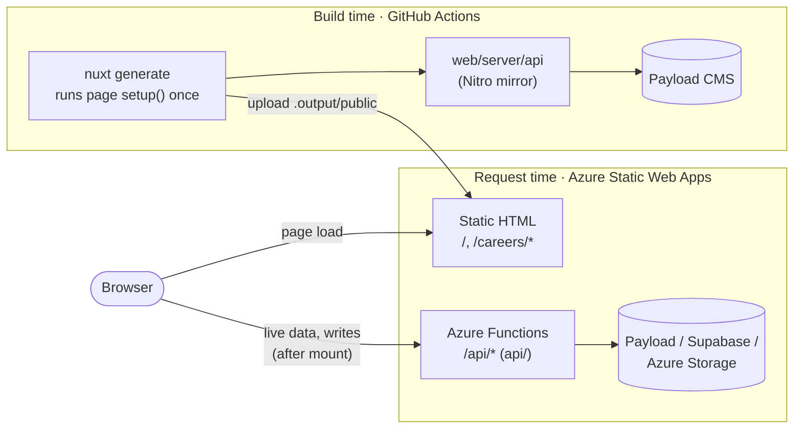
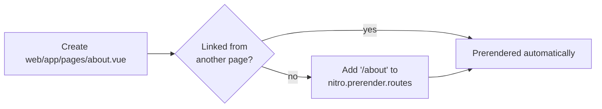
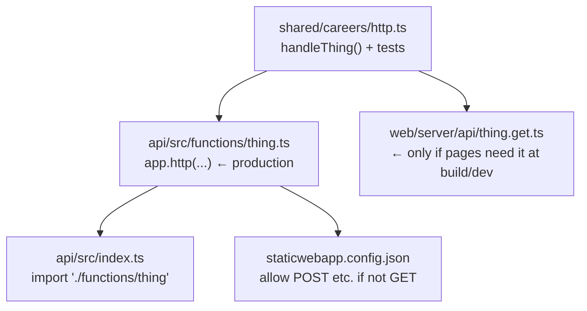
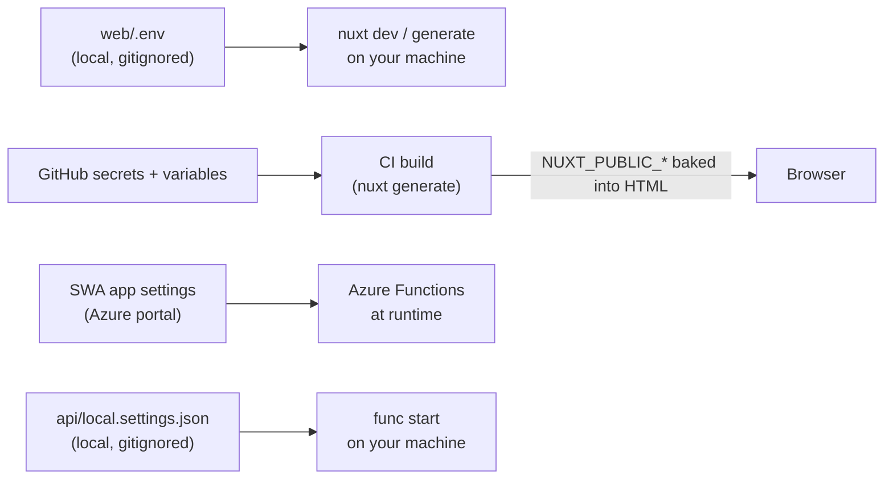
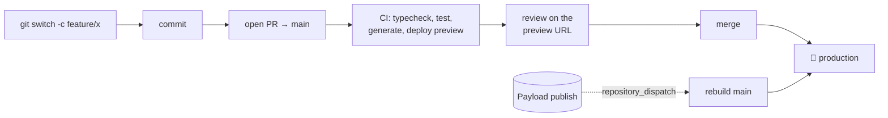

# Developer Manual

The short version of [How_to_contribute.md](How_to_contribute.md). Read this, run the quick start, and make your first change. Each section links to the full explanation.

---

## 1. The one idea to remember

You write normal Nuxt. But **pages are built once in CI, not rendered per request**. Anything that must happen per visitor goes in an **Azure Function**.



| Code in… | Runs | Deployed? |
|---|---|---|
| `web/app/**` (pages, components) | At build (prerender) **and** in the browser | ✅ as static files |
| `web/server/**` | Only in `nuxt dev` / `nuxt generate` | ❌ **never** |
| `api/**` (Azure Functions) | Per request, at `/api/*` | ✅ |
| `shared/**` | Imported by both of the above | ✅ (bundled) |

---

## 2. Quick start (5 minutes)

```bash
cd web
npm install
cp .env.example .env
npm run mock:payload     # terminal 1: fake CMS on :3001
npm run dev              # terminal 2: http://localhost:3000
```

| I want to… | Command |
|---|---|
| Develop with hot reload | `cd web && npm run dev` |
| Use the real CMS | Set `PAYLOAD_URL` and `PAYLOAD_API_KEY` in `web/.env`, then **restart** dev |
| Build what production gets | `cd web && npm run generate` → `web/.output/public` |
| Run tests | `cd api && npm test` |
| Type-check | `cd api && npm run typecheck` and `cd web && npm run typecheck` |
| Emulate production (Functions, headers, auth) | See [How_to_contribute §4](How_to_contribute.md#4-local-development) |

> ⚠️ `nuxt dev` renders per request, so it can hide production bugs. **Run `npm run generate` before every PR.**

---

## 3. Where do I change…?

| Change | File(s) |
|---|---|
| Home page | `web/app/pages/index.vue` |
| Career list / career detail | `web/app/pages/careers/index.vue`, `web/app/pages/careers/[slug].vue` |
| Career card | `web/app/components/CareerCard.vue` |
| Header, footer, nav | `web/app/layouts/default.vue` |
| Colours, spacing, fonts | `web/app/assets/css/main.css` (CSS variables at the top) |
| Site name, favicon | `NUXT_PUBLIC_SITE_NAME` in `.env` and the GitHub variable `SITE_NAME`; `web/public/favicon.svg` |
| Error / 404 page | `web/app/error.vue` |
| How CMS HTML is rendered | `shared/careers/rich-text.ts`, `web/app/components/RichText.vue` |
| Which Payload fields are fetched, filters, sort | `shared/careers/payload-client.ts` |
| API validation, status codes, caching | `shared/careers/http.ts` |
| Security headers (CSP), redirects, API methods | `web/public/staticwebapp.config.json` |
| Which pages get prerendered | `web/nuxt.config.ts` → `nitro.prerender`, `prerender:routes` hook |
| Mock CMS data | `tools/mock-payload/careers.json` |
| CI/CD | `.github/workflows/azure-static-web-apps.yml` |

---

## 4. Recipes

### Add a page



### Show CMS data on a page

```vue
<script setup lang="ts">
const { data } = await useFetch('/api/careers', { query: { limit: 6 } })  // runs at BUILD time → baked into HTML
useRevalidate(async () => { data.value = await $fetch('/api/careers', { query: { limit: 6 } }) }) // refreshes in the browser
</script>
```

For dynamic routes (`[slug].vue`), also add slug discovery to the `prerender:routes` hook in `nuxt.config.ts`.

### Add an API endpoint

Write the logic once in `shared/`, then wire it up in 3–4 places:



Full example: [How_to_contribute §7.2](How_to_contribute.md#72-add-a-new-api-endpoint).

### Integrations at a glance

| Integration | Browser | Azure Function (`api/`) | Separate Functions app | Details |
|---|---|---|---|---|
| **Payload CMS**: read content | – | ✅ live reads | – | [§7.3](How_to_contribute.md#73-payload-cms) |
| **Azure Storage queue**: send | – | ✅ `@azure/storage-queue` | – | [§7.4 A](How_to_contribute.md#74-integrate-azure-storage-queues) |
| **Azure Storage queue**: process | – | ❌ (HTTP triggers only) | ✅ `app.storageQueue` | [§7.4 B](How_to_contribute.md#74-integrate-azure-storage-queues) |
| **Supabase Auth** | ✅ supabase-js, publishable key | ✅ verify token (`x-supabase-auth`) | – | [§7.5](How_to_contribute.md#75-supabase-for-database-and-auth) |
| **Supabase DB**: user's own rows | ✅ protected by **RLS** | – | – | [§7.5](How_to_contribute.md#75-supabase-for-database-and-auth) |
| **Supabase DB**: privileged | – | ✅ secret key | – | [§7.5](How_to_contribute.md#75-supabase-for-database-and-auth) |
| Timers / cron | – | ❌ | ✅ or GitHub `schedule:` | [§2](How_to_contribute.md#2-from-a-vm-deployment-to-swa-concept-mapping) |

Calling **any** new origin from the browser? Add it to `connect-src` in `staticwebapp.config.json`, or the browser will block it.

---

## 5. Config and secrets: where they go



| Kind of value | Put it in | Example |
|---|---|---|
| Needed to **build** pages | GitHub **secret/variable** (and `web/.env` locally) | `PAYLOAD_URL`, `PAYLOAD_API_KEY` |
| Needed by **Functions** at runtime | **SWA app settings** (and `api/local.settings.json` locally) | `PAYLOAD_URL`, `AZURE_STORAGE_CONNECTION_STRING`, `SUPABASE_SECRET_KEY` |
| Public, used in the **browser** | GitHub **variable** as `NUXT_PUBLIC_*` (rebuild to apply) | `NUXT_PUBLIC_SITE_NAME`, `NUXT_PUBLIC_SUPABASE_KEY` |
| A secret | ❌ **Never** in `NUXT_PUBLIC_*`, code, or `*.example` files | |

---

## 6. Do / don't

| ✅ Do | ❌ Don't |
|---|---|
| Fetch content in `setup()` with `useFetch`; refresh with `useRevalidate` | Expect `setup()` to run per visitor |
| Put per-request logic in `api/` Functions | Put production logic in `web/server/` (it isn't deployed) |
| Render user- or time-specific UI after mount / in `<ClientOnly>` | Prerender anything personal (pages are public files) |
| Render CMS HTML with `<RichText>` | Use `v-html` |
| Use `staticwebapp.config.json` for headers and redirects | Use Nuxt server middleware or `routeRules` `isr`/`swr` |
| Enable RLS on every Supabase table | Send the Supabase secret key to the browser |
| Run `npm run generate` before pushing | Trust `nuxt dev` alone |

---

## 7. Ship it



**Before you open the PR:**
- [ ] `cd api && npm run typecheck && npm test`
- [ ] `cd web && npm run typecheck && npm run generate`
- [ ] New Function imported in `api/src/index.ts`; non-GET routes allowed in `staticwebapp.config.json`
- [ ] New browser origins added to the CSP
- [ ] New env vars added to `.env.example` / `local.settings.example.json`, the workflow `env:` and the README
- [ ] No secrets committed

**Something broke?**

| Symptom | Likely cause |
|---|---|
| Works in dev, broken in production | Relied on runtime SSR, `web/server/` or cookies ([§3](How_to_contribute.md#3-what-works-what-doesnt)) |
| Old content on the site | Expected until the next build; check the publish hook ran in GitHub *Actions* |
| `Payload returned HTTP 400` | Querying a field the collection lacks, e.g. `PAYLOAD_DRAFTS=true` (README → *Troubleshooting*) |
| Browser "Refused to connect" | Add the origin to the CSP |
| Hydration mismatch | Time- or user-specific output during prerender; move it to `onMounted` |

Full details: [How_to_contribute.md](How_to_contribute.md) · Setup and deploy: [README.md](README.md)
